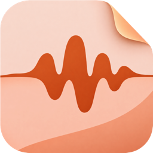
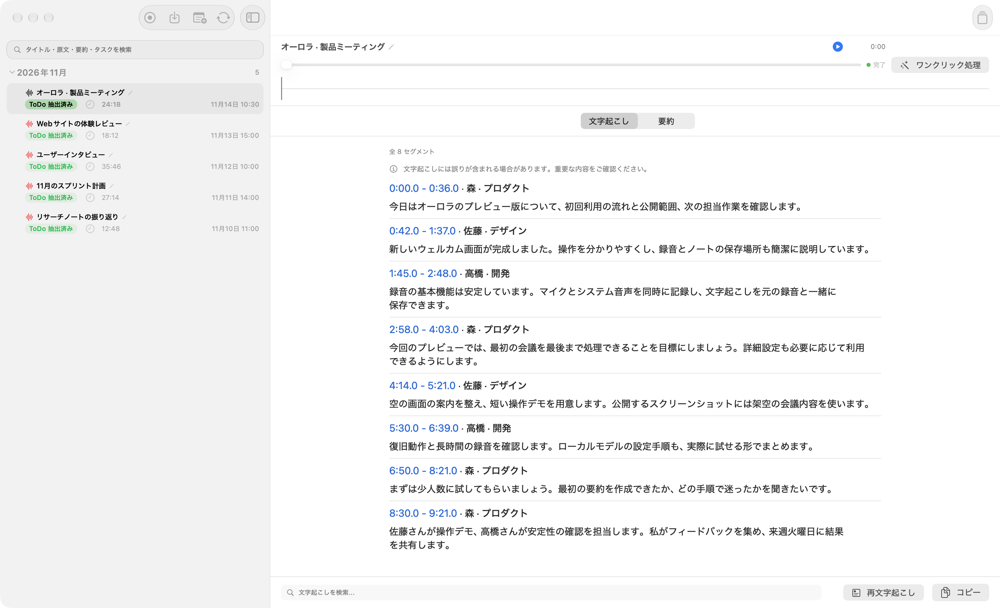
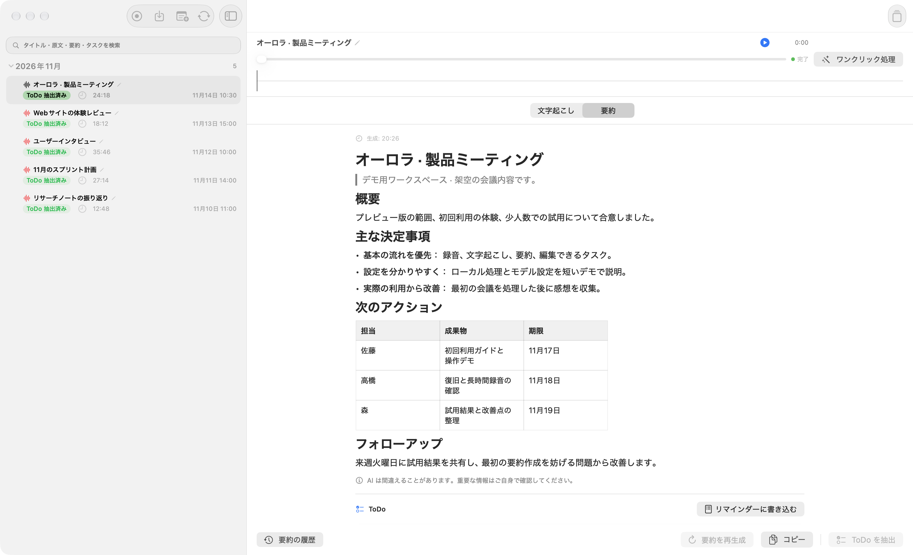
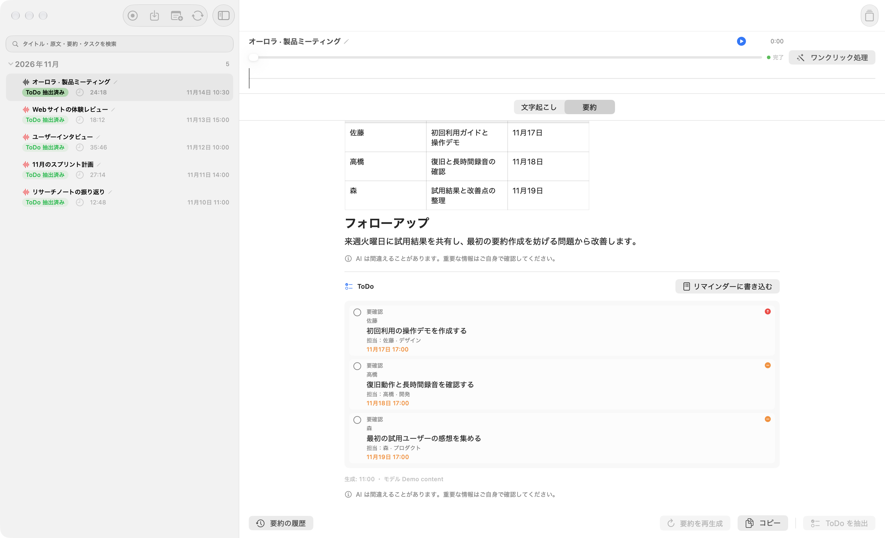
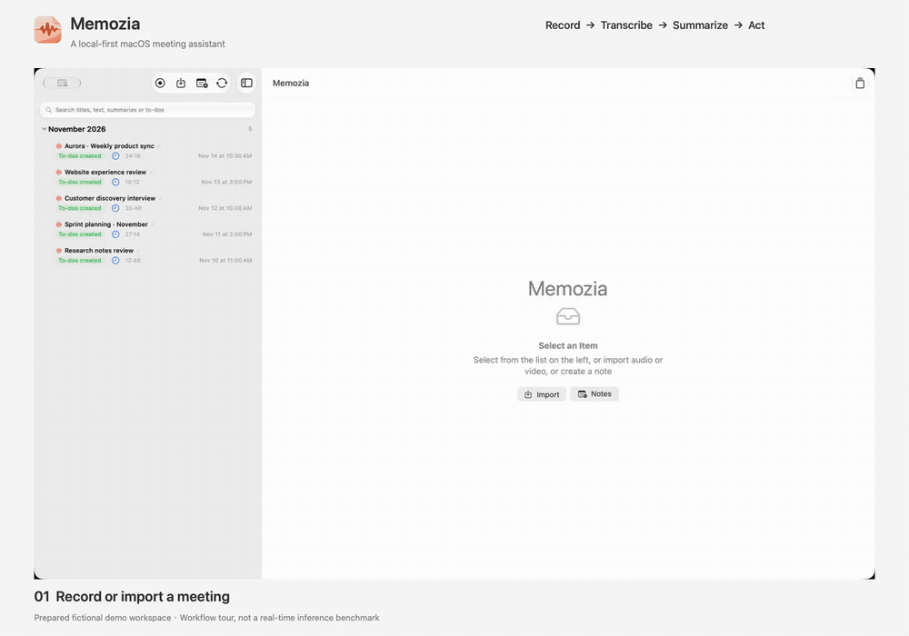

<h1 align="center">Memozia</h1>

<strong>録音を文字起こし、要約、タスクへ。ローカル処理に対応した Mac 用会議アシスタント。</strong>

<a href="https://github.com/oceanix-pr/Memozia/releases"><strong>プレビュー版をダウンロード</strong></a> · <a href="#使い始める">使い始める</a> · <a href="docs/articles/README.md">技術記事</a> · <a href="CONTRIBUTING.md">開発に参加</a>

<strong>Apple Silicon · macOS 15 以降 · プレビュー版</strong> ソースコードは MIT ライセンス · モデルは別途ダウンロード

<a href="README.md">English</a> · <a href="README.zh-CN.md">简体中文</a> · 日本語 · <a href="README.ko.md">한국어</a>

## 会議の記録から次のアクションへ

マイクとシステム音声を録音するか、既存の音声・動画を読み込みます。話者ラベル付きの文字起こしと要約を確認し、タスクを編集してから「リマインダー」への書き込みを選べます。

<table>
  <tr>
    <td width="33%"></td>
    <td width="33%"></td>
    <td width="33%"></td>
  </tr>
  <tr><td align="center">文字起こし</td><td align="center">要約</td><td align="center">タスク</td></tr>
</table>

### 45 秒のワークフローデモ

[MP4 を見る・ダウンロードする](docs/assets/demo/memozia-workflow.mp4)。英語 UI の実際のウインドウを録画しています。事前に用意した架空の会議データを使い、操作の流れを示しています。文字起こしや推論の処理時間を示すものではありません。

## 使い始める

1. **インストール。** [Releases](https://github.com/oceanix-pr/Memozia/releases) から ZIP をダウンロードして展開し、`Memozia.app` を「アプリケーション」へ移動します。現在は Apple Silicon 向けプレビュー版で、Apple Developer ID による署名・公証はありません。初回起動の案内は各リリースの説明を確認してください。インストールに Xcode は不要です。
2. **モデルの準備。** 最初の文字起こしでアプリの案内に従い音声モデルを準備します。ローカルで要約やタスクを作るには、実行中の [Ollama または LM Studio](docs/articles/local-meeting-notes.md) に接続します。クラウドサービスも設定でき、送信される内容は選んだ設定によって変わります。
3. **録音・読み込み。** 会議を録音するか、音声・動画を読み込みます。選択した機能に必要なマイクや画面収録の権限を許可してください。
4. **確認して活用。** ワンクリック処理を使うか、文字起こし・要約・タスク抽出を個別に行います。結果を確認、編集した後で「リマインダー」への書き込みを選びます。

## 主な機能

- WhisperKit によるデバイス上の文字起こし。ローカル言語モデルを組み合わせれば、モデルの準備後は要約とタスクもローカルで処理できます。
- SwiftUI、メニューバー、マイクとシステム音声の録音、任意の「リマインダー」連携。
- 録音、文字起こし、要約、タスクを同じ項目にまとめるファイル中心の保存方式。
- スクリーンショットの注釈、OCR、テキスト・画像ノート、音声・動画の読み込み。
- OpenAI 互換エンドポイント、Ollama、LM Studio、21 の UI ロケール。

## データの扱い

記録とノートは標準で Mac に保存されます。クラウド文字起こしは音声を、リモートの言語・画像モデルは必要なテキストや画像などを送信します。テキストのマスキングは画像や動画フレームには適用されません。API キーと暗号化キーは macOS キーチェーンを使います。モデルのダウンロードと更新確認も通信を行います。

[問題を報告する](https://github.com/oceanix-pr/Memozia/issues/new/choose) · [貢献ガイド](CONTRIBUTING.md) · [ソースからのビルド](docs/BUILDING.md) · [技術記事](docs/articles/README.md)

ソースコードは [MIT ライセンス](LICENSE) です。依存ライブラリ、辞書、ダウンロードしたモデルにはそれぞれのライセンスが適用されます。名称やアイコンなどの商標利用権はソースコードのライセンスに含まれません。
