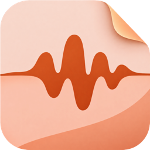
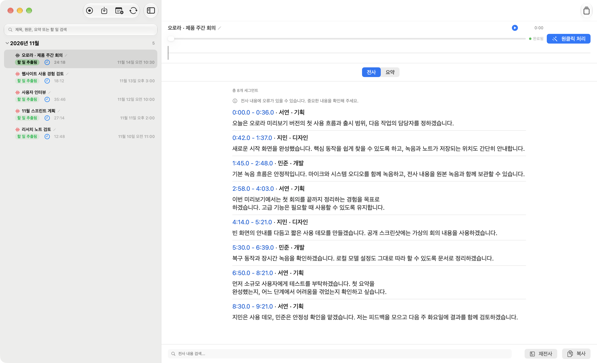
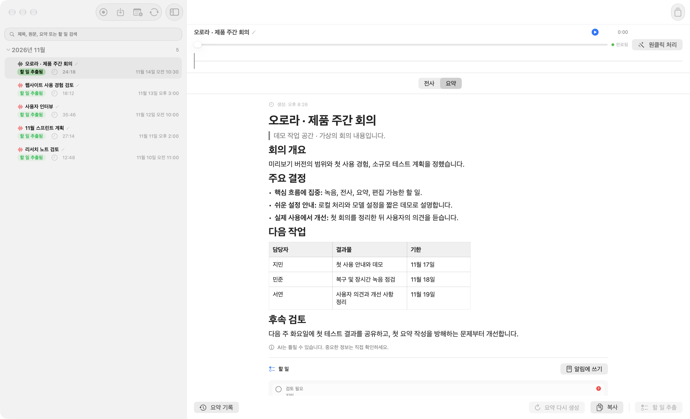
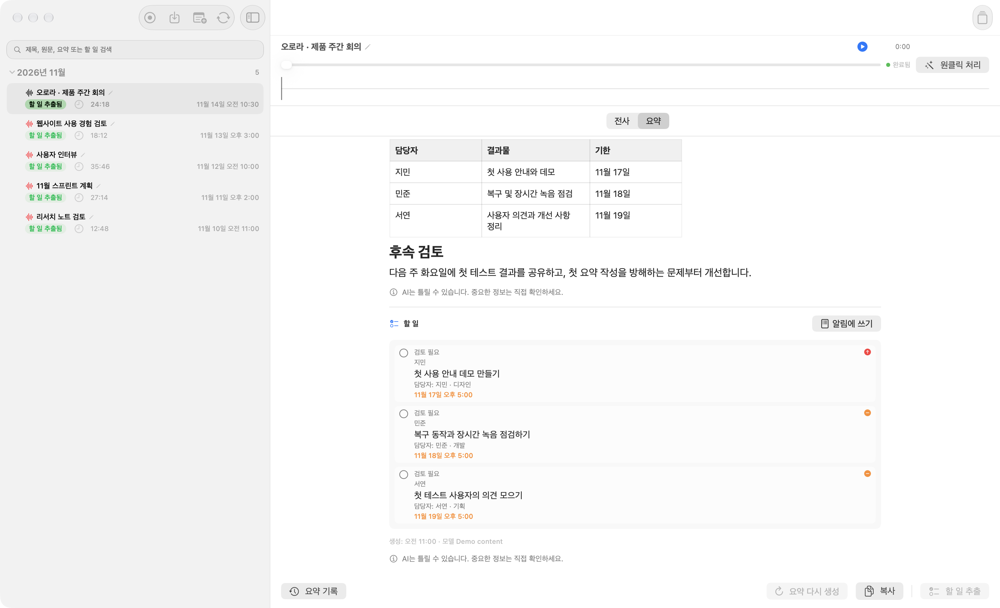
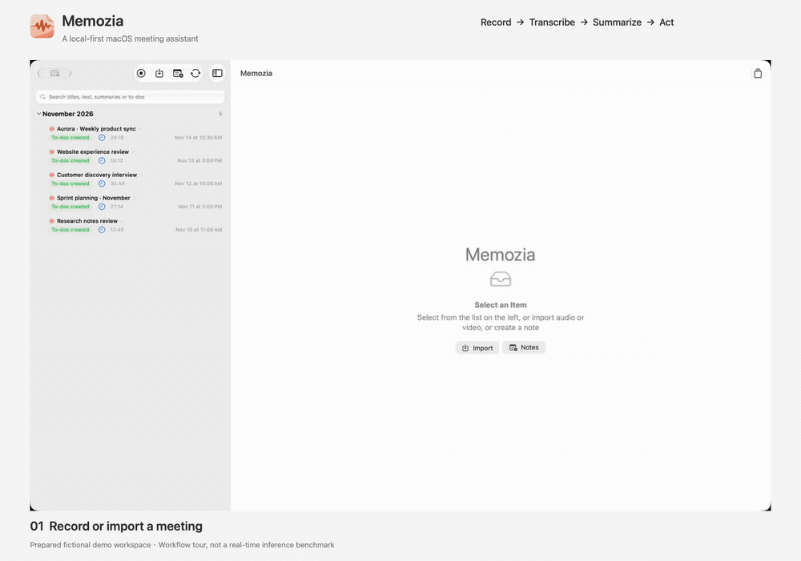

<h1 align="center">Memozia</h1>

<strong>녹음을 전사, 요약, 할 일로 정리하는 로컬 우선 Mac 회의 도우미.</strong>

<a href="https://github.com/oceanix-pr/Memozia/releases"><strong>미리보기 다운로드</strong></a> · <a href="#시작하기">시작하기</a> · <a href="docs/articles/README.md">기술 문서</a> · <a href="CONTRIBUTING.md">기여하기</a>

<strong>Apple Silicon · macOS 15 이상 · 미리보기</strong> MIT 라이선스 소스 코드 · 모델은 별도 다운로드

<a href="README.md">English</a> · <a href="README.zh-CN.md">简体中文</a> · <a href="README.ja.md">日本語</a> · 한국어

## 회의 기록에서 다음 작업까지

마이크와 시스템 오디오를 녹음하거나 기존 음성·동영상을 가져옵니다. 화자가 표시된 전사와 요약을 확인하고 할 일을 편집한 뒤 macOS 미리 알림에 쓸지 선택할 수 있습니다.

<table>
  <tr>
    <td width="33%"></td>
    <td width="33%"></td>
    <td width="33%"></td>
  </tr>
  <tr><td align="center">전사</td><td align="center">요약</td><td align="center">할 일</td></tr>
</table>

### 45초 작업 흐름 데모

[MP4 보기 또는 다운로드](docs/assets/demo/memozia-workflow.mp4). 영어 UI의 실제 앱 창을 녹화했습니다. 미리 준비한 가상의 회의 데이터로 조작 흐름을 보여 주며 전사나 모델 추론의 실제 처리 시간을 나타내지 않습니다.

## 시작하기

1. **설치.** [Releases](https://github.com/oceanix-pr/Memozia/releases)에서 ZIP을 내려받아 압축을 풀고 `Memozia.app`을 응용 프로그램으로 옮깁니다. 현재는 Apple Silicon용 미리보기이며 Apple Developer ID 서명과 공증을 받지 않았습니다. 처음 실행하는 방법은 해당 릴리스 설명을 확인하세요. 앱 설치에 Xcode는 필요하지 않습니다.
2. **모델 준비.** 처음 전사할 때 앱 안내에 따라 음성 모델을 준비합니다. 요약과 할 일을 로컬에서 만들려면 실행 중인 [Ollama 또는 LM Studio](docs/articles/local-meeting-notes.md)에 연결합니다. 클라우드 서비스도 설정할 수 있으며 전송되는 내용은 선택한 설정에 따라 달라집니다.
3. **녹음 또는 가져오기.** 회의를 녹음하거나 음성·동영상을 가져옵니다. 사용하는 기능에 필요한 마이크와 화면 기록 권한을 허용하세요.
4. **검토하고 활용.** 원클릭 처리를 사용하거나 전사, 요약, 할 일 추출을 따로 실행합니다. 결과를 확인하고 편집한 뒤 macOS 미리 알림에 쓸지 결정합니다.

## 주요 기능

- WhisperKit을 이용한 기기 내 전사. 로컬 언어 모델을 함께 쓰면 모델 준비 후 요약과 할 일도 로컬에서 처리할 수 있습니다.
- SwiftUI, 메뉴 막대, 마이크 및 시스템 오디오 녹음, 선택 가능한 미리 알림 연동.
- 녹음, 전사, 요약, 할 일을 하나의 항목으로 묶는 파일 중심 저장 방식.
- 스크린샷 주석, OCR, 텍스트·이미지 노트, 음성·동영상 가져오기.
- OpenAI 호환 엔드포인트, Ollama, LM Studio, 21개 UI 로캘.

## 데이터 처리

기록과 노트는 기본적으로 Mac에 저장됩니다. 클라우드 전사는 음성을, 원격 언어·시각 모델은 요청에 필요한 텍스트나 이미지 등을 전송합니다. 텍스트 비식별화는 이미지와 동영상 프레임에는 적용되지 않습니다. API 키와 암호화 키는 macOS 키체인을 사용합니다. 모델 다운로드와 업데이트 확인도 네트워크를 사용합니다.

[문제 신고](https://github.com/oceanix-pr/Memozia/issues/new/choose) · [기여 가이드](CONTRIBUTING.md) · [소스 빌드](docs/BUILDING.md) · [기술 문서](docs/articles/README.md)

소스 코드는 [MIT 라이선스](LICENSE)입니다. 의존 라이브러리, 사전, 다운로드한 모델에는 각자의 라이선스가 적용됩니다. 이름이나 아이콘 등의 상표 사용권은 소스 코드 라이선스에 포함되지 않습니다.
