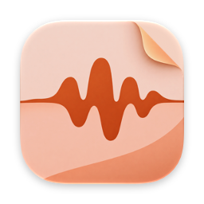
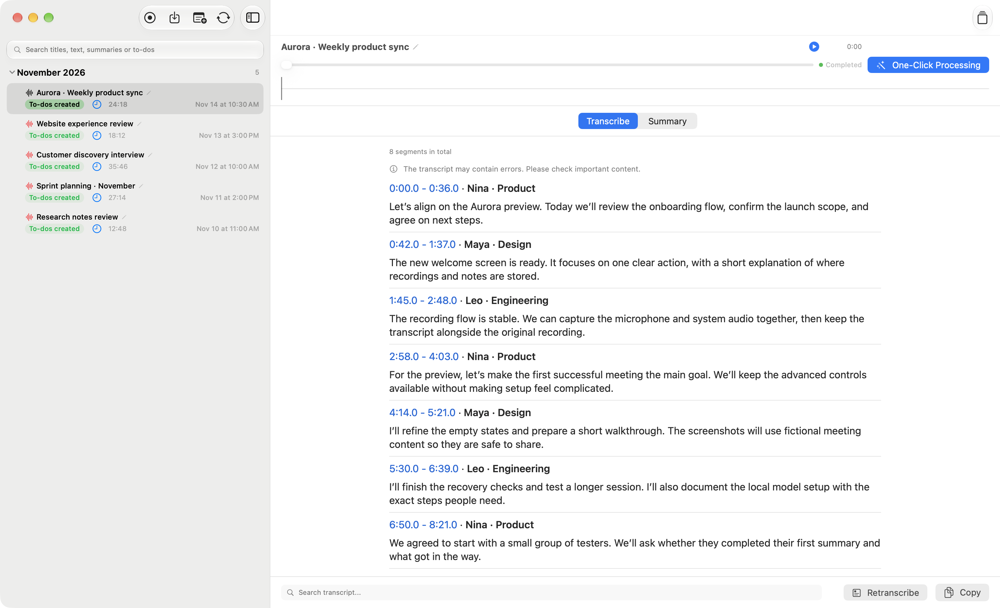
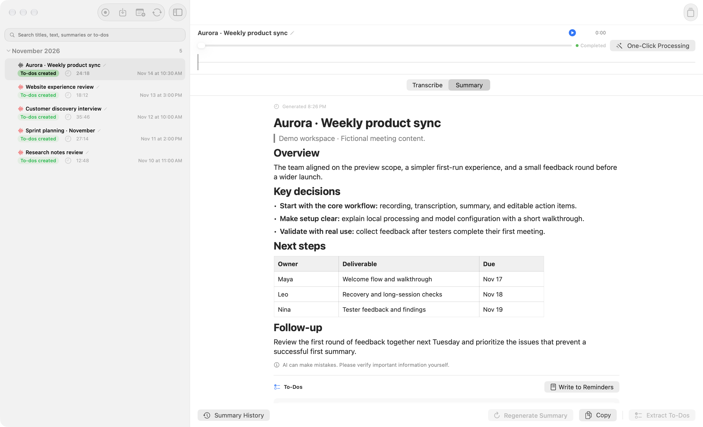
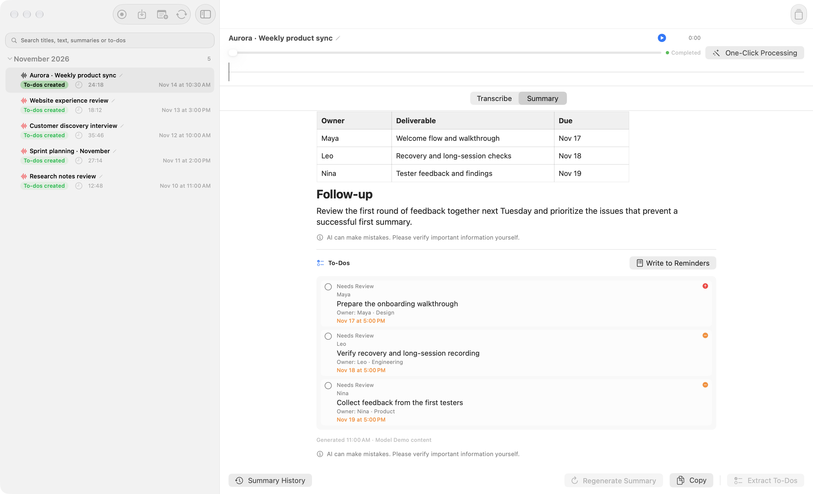
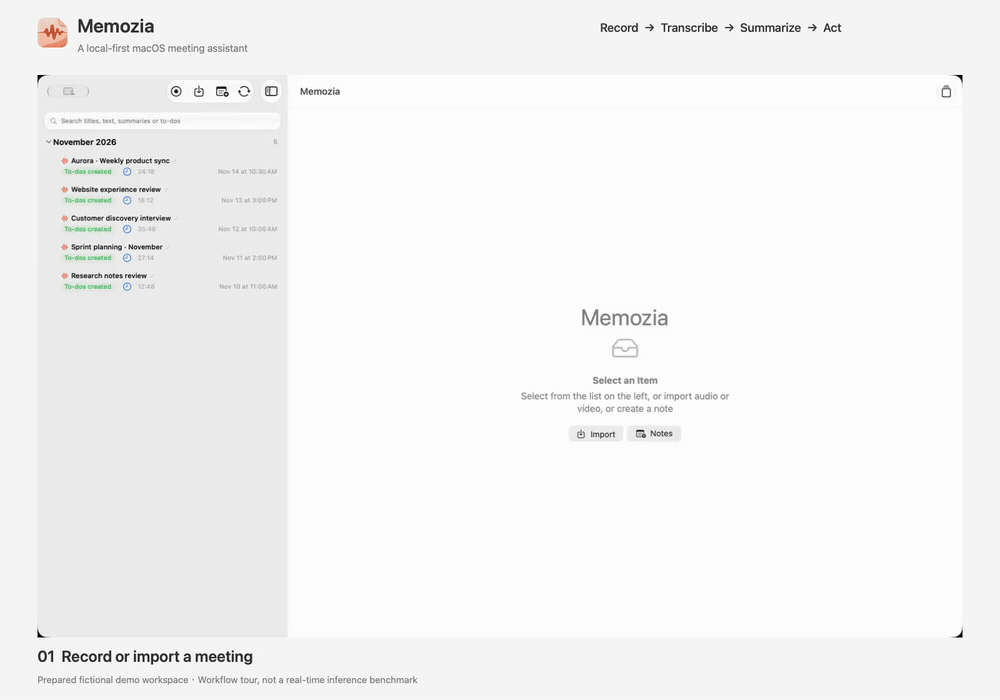

<h1 align="center">Memozia</h1>

<strong>A local-first macOS meeting assistant that turns recordings into transcripts, summaries, and action items.</strong>

  <a href="https://github.com/oceanix-pr/Memozia/releases"><strong>Download the preview</strong></a> ·
  <a href="#get-started">Get started</a> ·
  <a href="docs/articles/README.md">How it works</a> ·
  <a href="CONTRIBUTING.md">Contribute</a>

<strong>Apple Silicon · macOS 15+ · Preview</strong> MIT-licensed source · Models downloaded separately

  English · <a href="README.zh-CN.md">简体中文</a> · <a href="README.ja.md">日本語</a> · <a href="README.ko.md">한국어</a> 
  <a href="docs/PRODUCT_REFERENCE.md#繁體中文">繁體中文</a> · <a href="docs/PRODUCT_REFERENCE.md#español">Español</a> · <a href="docs/PRODUCT_REFERENCE.md#français">Français</a>

## From a meeting to your next steps

Record your microphone and system audio, or import an existing recording. Review a speaker-labelled transcript, read a structured summary, and edit the next actions before sending them to Reminders.

<table>
  <tr>
    <td width="33%"></td>
    <td width="33%"></td>
    <td width="33%"></td>
  </tr>
  <tr><td align="center">Transcript</td><td align="center">Summary</td><td align="center">Action items</td></tr>
</table>

### Watch the 45-second workflow tour

[Watch or download the MP4](docs/assets/demo/memozia-workflow.mp4). Screenshots and the tour use prepared fictional meeting content. The tour shows app navigation, not real-time transcription or model inference speed.

## Get started

1. **Install.** Download the ZIP from [Releases](https://github.com/oceanix-pr/Memozia/releases), unzip it, and move `Memozia.app` to Applications. The current preview is for Apple Silicon and is not signed with Apple Developer ID or notarized. Read its release notes for macOS first-open instructions. Installing the app does not require Xcode.
2. **Prepare speech and summary models.** Follow the in-app component preparation when you first transcribe. For local summaries, connect a running [Ollama or LM Studio service](docs/articles/local-meeting-notes.md). You can also configure a cloud service. The settings you choose determine which content leaves your Mac.
3. **Record or import.** Start a meeting recording, or use Import to bring in audio or video. On first use, grant the permissions needed for your chosen recording source.
4. **Review and act.** Use One-Click Processing or work through transcription and summary separately. Review the transcript and summary, then edit the action items. Writing to macOS Reminders requires your confirmation.

## Why Memozia

- **Local processing when you choose it.** WhisperKit transcription runs on your Mac. Pair it with a local language model for local summaries and action items after model setup.
- **A native Mac workflow.** SwiftUI, microphone and system-audio recording, a menu-bar entry point, and optional Reminders integration.
- **Recordings stay connected to their notes.** Audio, transcripts, summaries, and tasks share a file-first workspace that can be backed up and recovered.
- **More ways to capture context.** Import audio and video, capture and annotate screenshots, run OCR, and keep text and image notes.
- **Your preferred model and language.** OpenAI-compatible endpoints, Ollama, LM Studio, and 21 interface locales. The screenshot set covers English, Simplified Chinese, Japanese, and Korean.

## Where your data goes

Recordings and notes are stored locally by default. Choosing cloud transcription uploads audio; choosing a remote language or vision model sends the content needed for that request. Local text redaction does not redact images or video frames. API keys and encryption keys use macOS Keychain.

See the app's privacy policy and the [product reference](docs/PRODUCT_REFERENCE.md) for details. Model downloads and update checks also use the network.

## Learn, contribute, and report issues

- [Local meeting notes with WhisperKit and Ollama](docs/articles/local-meeting-notes.md)
- [Recording microphone and system audio on macOS](docs/articles/macos-audio-capture.md)
- [Segmented recording, recovery, and long-meeting transcription](docs/articles/long-recording-recovery.md)
- Email bug reports and feature requests to [oceanix-pr@outlook.com](mailto:oceanix-pr@outlook.com).
- [Contribution guide](CONTRIBUTING.md) · [Build from source](docs/BUILDING.md) · [Architecture and implementation](docs/wiki/en/Home.md)
- [Security policy](SECURITY.md) · [Third-party notices](THIRD_PARTY_NOTICES.md)

Memozia source is released under the [MIT License](LICENSE). Third-party libraries, dictionaries, and downloaded models retain their own licenses. The Memozia name and icon are not licensed as trademarks by the MIT source license.
