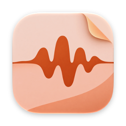
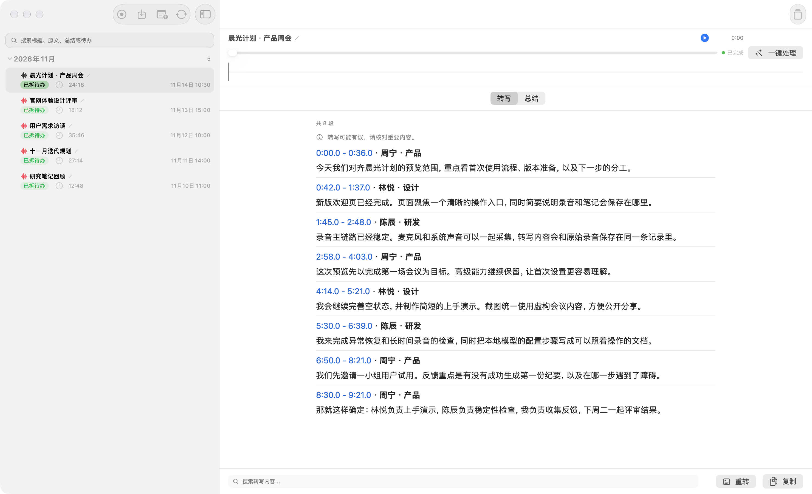
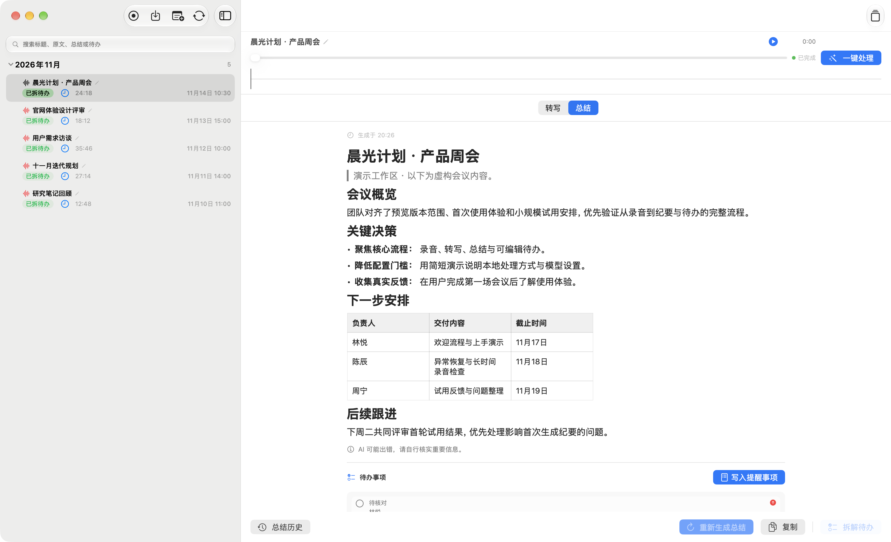
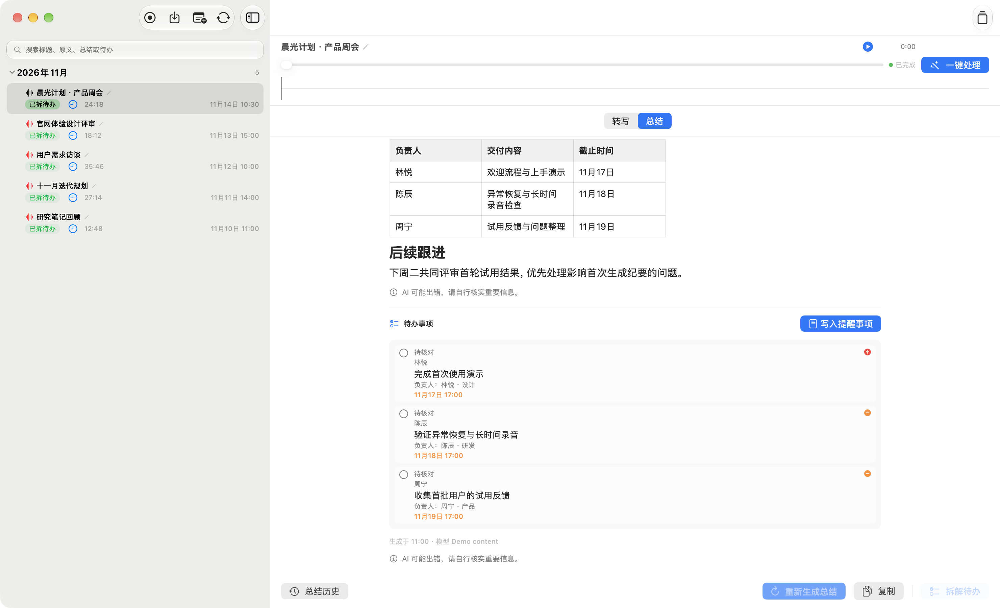
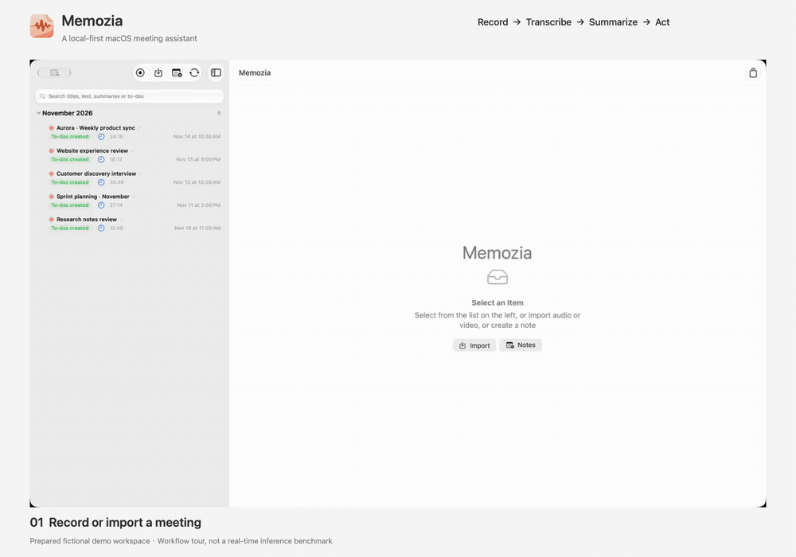

<h1 align="center">Memozia · 闻墨集</h1>

<strong>支持本地处理的 Mac 会议助手，把录音变成文字、纪要和待办。</strong>

<a href="https://github.com/oceanix-pr/Memozia/releases"><strong>下载预览版</strong></a> · <a href="#开始使用">开始使用</a> · <a href="docs/articles/README.md">技术文章</a> · <a href="CONTRIBUTING.md">参与贡献</a>

<strong>Apple Silicon · macOS 15+ · 预览版</strong> MIT 开源 · 模型按需另行下载

<a href="README.md">English</a> · 简体中文 · <a href="README.ja.md">日本語</a> · <a href="README.ko.md">한국어</a> · <a href="docs/PRODUCT_REFERENCE.md#繁體中文">繁體中文</a>

## 从会议记录到下一步行动

同时录下麦克风和系统声音，或导入已有录音。会后核对带说话人标注的转写，阅读结构化纪要，再编辑待办并确认是否写入系统提醒事项。

<table>
  <tr>
    <td width="33%"></td>
    <td width="33%"></td>
    <td width="33%"></td>
  </tr>
  <tr><td align="center">转写</td><td align="center">总结</td><td align="center">待办</td></tr>
</table>

### 45 秒流程演示

[查看或下载 MP4](docs/assets/demo/memozia-workflow.mp4)。视频为英语界面的实际窗口录制。截图与视频使用预先准备的虚构会议内容，展示操作流程，不代表转写或模型推理的实际耗时。

## 开始使用

1. **安装应用。** 从 [Releases](https://github.com/oceanix-pr/Memozia/releases) 下载 ZIP，解压后把 `Memozia.app` 移到「应用程序」。当前为 Apple Silicon 预览包，未经 Apple Developer ID 签名及公证；首次打开方式以该版本发布说明为准。安装应用不需要 Xcode。
2. **准备模型。** 首次转写时按应用提示准备语音组件。若想在本机生成总结和待办，可连接已运行的 [Ollama 或 LM Studio](docs/articles/local-meeting-notes.md)；也可自行配置云端服务。是否上传内容取决于所选配置。
3. **录音或导入。** 开始会议录音，或通过「导入」加入音频、视频。按录音来源授予麦克风或系统录音权限；截图和录屏时才需要屏幕权限。
4. **核对结果。** 使用「一键处理」，或分别进行转写、总结和待办提取。核对并编辑内容后，再决定是否写入 macOS 提醒事项。

## 适合你的工作流

- **可选择本地处理：** WhisperKit 在本机转写，配合本地大模型，可在模型准备完成后本地生成纪要和待办。
- **原生 Mac 体验：** SwiftUI 界面、菜单栏入口、麦克风与系统声音采集，以及可选的提醒事项集成。
- **文件优先：** 录音、转写、总结与待办归入同一条目，方便查看、备份与恢复。
- **记录更多上下文：** 支持音视频导入、截图标注、OCR，以及文字和图片笔记。
- **灵活接入：** 支持 OpenAI 兼容接口、Ollama、LM Studio 和 21 个界面语言区域；已有英、中、日、韩界面截图。

## 数据处理方式

资料默认保存在本机。选择云端转写会上传音频；选择远端语言或视觉模型，会发送相应文本、图片或视频帧。本地文本脱敏不适用于图片与视频帧。API Key 与加密密钥存放在 macOS 钥匙串。

模型下载、更新检查也会联网。具体说明见应用内隐私政策与[产品参考](docs/PRODUCT_REFERENCE.md)。

## 了解实现与参与贡献

- [WhisperKit 与 Ollama 本地会议纪要指南](docs/articles/local-meeting-notes.md)（英文，附中文要点）
- [macOS 双路音频采集实践](docs/articles/macos-audio-capture.md)（英文，附中文要点）
- [长会议分片、恢复和转写](docs/articles/long-recording-recovery.md)（英文，附中文要点）
- Bug 和功能需求可发送至 [oceanix-pr@outlook.com](mailto:oceanix-pr@outlook.com)。
- [贡献指南](CONTRIBUTING.md) · [源码构建](docs/BUILDING.md) · [项目 Wiki](docs/wiki/Home.md)
- [安全政策](SECURITY.md) · [第三方声明](THIRD_PARTY_NOTICES.md)

源代码使用 [MIT 许可证](LICENSE)。第三方依赖、词典和另行下载的模型适用各自许可证；源代码许可证不自动授予 Memozia 名称、图标或商标的使用权。
