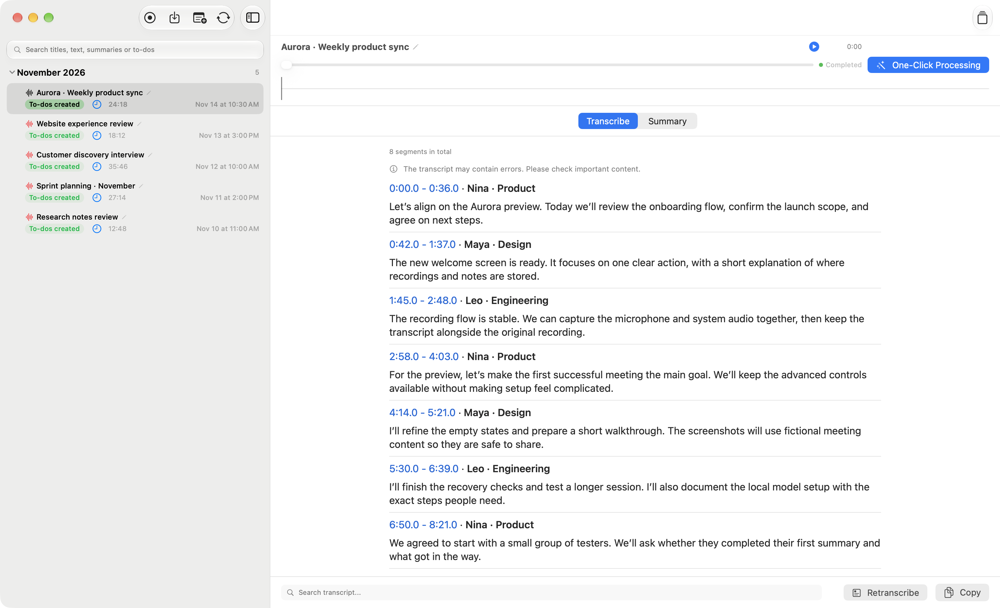

# Local meeting notes with WhisperKit and Ollama

Memozia connects two different jobs: speech recognition turns audio into timestamped text, then a language model turns that text into a summary and proposed tasks. Keeping these stages separate makes the result easier to check and lets users choose local or remote processing at each step.



## The processing path

| Stage | Memozia implementation | Result to review |
| --- | --- | --- |
| Record or import | A local audio or video entry | Playback and recording duration |
| Transcribe locally | WhisperKit through `WhisperLocalService` | Text and timestamps |
| Label speakers, when enabled | A separate sherpa-onnx diarization stage | Speaker assignments |
| Summarize | An OpenAI-compatible chat endpoint, such as local Ollama | Decisions, context, and proposed actions |
| Act | Editable tasks and a confirmed Reminders write | Owners, wording, and dates |

Speaker diarization is a separate component; WhisperKit is not being credited with the whole pipeline. Likewise, a task suggested by a language model needs human review before it becomes a reminder.

## Reproduce a short local workflow

1. Install the [Apple Silicon preview](https://github.com/oceanix-pr/Memozia/releases) on macOS 15 or later. Prepare a short recording containing only fictional information. For example: “Maya will draft the welcome page by Friday. Leo will review it. We have not decided the launch date.”
2. Complete Memozia's speech-component preparation and choose local WhisperKit transcription. Model downloads need network access; having a downloaded app alone is not enough for offline transcription.
3. Install and run [Ollama](https://docs.ollama.com/quickstart). Choose a model that is actually running locally and fits your Mac. In Terminal, check the installed model names and local endpoint:

   ```sh
   ollama list
   curl --fail http://127.0.0.1:11434/v1/models
   ```

4. In Memozia's language-model settings, select the Ollama preset. Use `http://localhost:11434` as the base URL and copy the exact installed model name. The preset is local and does not require an API key. Memozia appends `/v1/chat/completions` to a bare host URL. Ollama documents this interface in its [OpenAI compatibility guide](https://docs.ollama.com/api/openai-compatibility).
5. Import the short recording, transcribe it, and play back a few timestamps. Generate the summary and extract tasks. Check whether Maya is the owner, whether Leo's review is separate, and whether the undecided launch date stays undecided. Correct the proposed tasks before confirming a Reminders write.

LM Studio is another compatible local-service option; Memozia includes a preset for port `1234`. Use the model identifier and server configuration shown by your own installation.

## Integration details that matter

`WhisperLocalService` loads a model from a local folder and submits the audio path to WhisperKit with transcription decoding options. Its inference gate serializes requests and checks cancellation both around the asynchronous call and in the progress callback. A progress estimate based on decoding windows is UI feedback, not elapsed-time prediction.

The language-model stage uses the reviewed transcript as input. Larger models, different prompts, mixed languages, and long transcripts can change the output. A useful small regression sample includes an explicit decision, an assigned action, and something deliberately left unresolved; compare those facts rather than expecting identical prose.

For a local-content check, finish all model downloads first, choose local transcription and a local summary endpoint, then try the same short sample with external networking disconnected. Other features, including updates and optional cloud or vision services, have their own network behavior. Selecting a cloud transcription service uploads audio; selecting a remote language model sends request content to that endpoint.

## Read the implementation

- [WhisperKit integration](../../Memozia/Services/WhisperLocalService.swift)
- [Speaker diarization](../../Memozia/Services/SpeakerDiarizationService.swift)
- [Endpoint construction](../../Memozia/Models/LLMConfig.swift) and [Ollama/LM Studio presets](../../Memozia/ViewModels/LLMPreset.swift)
- [Summary requests](../../Memozia/Services/LLMService.swift)
- [45-second app tour](../assets/demo/memozia-workflow.mp4), using prepared fictional results

中文要点：WhisperKit 负责本地转写，说话人分离另走 sherpa-onnx，总结由用户选择的模型服务完成。Ollama 预设填写本机地址和已安装模型名即可；先完成模型下载，再检查全本地内容处理。验证时重点核对人物、日期、决策和“尚未决定”的内容。
